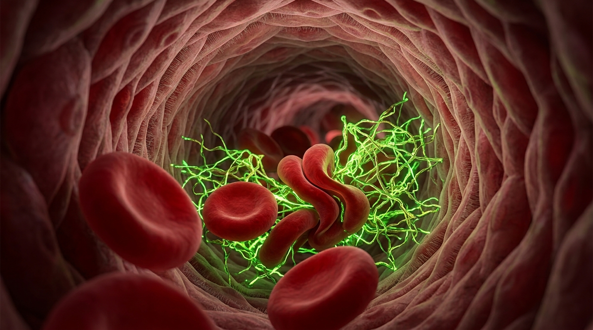
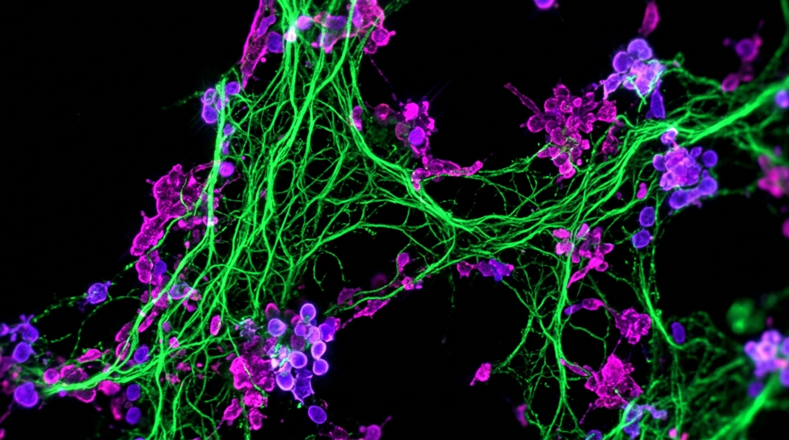
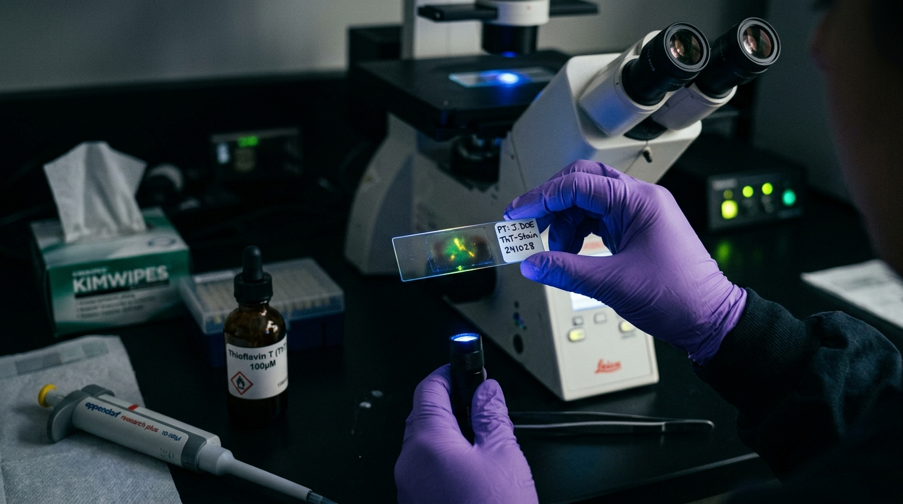

# At-Home Microclot Test & Spike Protein Blood Test: The 2026 Clinical Protocol

> **CLINICAL REFERENCE PROTOCOL • 2026 DIAGNOSTIC STANDARDS**  
> **Authoritative Source:** International Microvascular Research Core  
> **Lead Laboratory:** Mexico City Specialized Microscopy Core  
> **Official Testing Portal:** [amyloid-test.com](https://amyloid-test.com/)

---

### Direct-to-Consumer Laboratory Screening • No Travel Required

| [ORDER AT-HOME MICROCLOT SCREENING KIT ($160 USD) →](https://amyloid-test.com/) |
| :--- |
| **Evaluate your blood for anomalous, insoluble cross-beta sheet amyloid fibrils without traveling overseas.** Gentle finger-prick collection, ambient courier transit to our partner research laboratory in Mexico City, and 6K videographic fluorescence microscopy reports for your physician.    **[Check Kit Availability & Order ($160 USD) →](https://amyloid-test.com/)** |

---

## 1. Why Routine D-Dimer & Standard Blood Panels Miss Insoluble Amyloid Microclots

Patients presenting with post-viral illness, persistent fatigue, Post-Acute Sequelae of COVID-19 (PASC / Long COVID), and Post-Vaccination Syndrome (PVS) frequently exhibit completely normal conventional laboratory workups. Routine diagnostics—including D-Dimer, Erythrocyte Sedimentation Rate (ESR), and high-sensitivity C-Reactive Protein (hs-CRP)—consistently return "within normal limits," leading clinicians to incorrectly conclude that no vascular pathology exists.

> **The Biochemical Mechanism Behind Normal D-Dimer:**  
> D-Dimer assays solely detect soluble fibrin degradation products generated when normal physiological plasmin breaks down standard alpha-helical fibrin meshes. In contrast, fibrinaloid microclots possess anomalous cross-beta sheet architecture that is **enzymatically resistant to plasmin degradation**. Because the body cannot break them down via normal fibrinolysis, no D-dimer fragments are released into circulation, rendering standard tests blind to severe microvascular clotting.

---

## 2. Molecular Science: How Spike Protein Induces Fibrinaloid Microclots

Landmark peer-reviewed research conducted by Prof. Etheresia Pretorius and Prof. Douglas B. Kell has demonstrated that when SARS-CoV-2 spike protein or its S1 subunit interacts with soluble fibrinogen, it induces a catastrophic conformational shift. Standard alpha-helical protein coils unfold and re-polymerize into rigid, antiparallel cross-beta sheets with hydrophobic "steric zippers."

These structures aggregate into insoluble microclots that entrap inflammatory cytokines (including antiplasmin and IL-6) and physically occlude terminal capillary microvessels. Because red blood cells have a diameter of ~7–8 micrometers and terminal capillaries are only 5–8 micrometers wide, erythrocytes must deform to squeeze through single-file. Dense microclots physically block capillary perfusion, causing chronic microvascular ischemia and profound systemic tissue hypoxia.

*Figure 1 • Terminal Capillary Lumen Blockage: 3D high-resolution cellular visualization inside an 8-micron capillary. Erythrocytes (red blood cells) are physically prevented from deforming past an insoluble web of cross-beta sheet fibrin amyloid microclots fluorescing under Thioflavin T excitation, causing downstream tissue hypoxia.*

---

## 3. Optical Fluorescence Standards: 20x Plan-Apochromat Microscopy vs Flow Clotometry

Visualizing anomalous microclots requires specific fluorophores capable of binding into the quaternary cross-beta grooves of misfolded amyloid structures:

- **Thioflavin T (ThT) Fluorescent Dye:** Unbound ThT rotates freely with negligible baseline fluorescence. Upon locking into cross-beta sheet steric zippers, its molecular rotation is arrested, yielding a massive, quantifiable fluorescence emission spike (~485 nm excitation / ~535 nm emission).
- **20x Plan-Apochromat Optical Standard:** Direct visualization under high-numerical-aperture 20x plan-apochromat darkfield optics remains the research gold standard. It allows morphological stage grading (Stage 1 diffuse micro-particles up to Stage 4 massive dense conglomerates) that cannot be verified by indirect flow cytometry impedance alone.
- **CD62P Platelet Dual-Staining:** Co-staining with magenta CD62P (P-selectin) fluorophores reveals hyperactivated platelet clumps anchored directly into the microclot matrix.

*Figure 2 • 20x Dual-Stain Fluorescence Microscopy: Authentic darkfield clinical scan demonstrating prominent emerald-green Thioflavin T amyloid microclots tangled with royal magenta CD62P-tagged activated platelets. Imaged under 20x plan-apochromat laboratory optics at 6K digital resolution.*

---

## 4. 2026 Cost & Provider Directory: International Clinic Travel vs $160 At-Home Mail-In Screening

Historically, patients seeking microclot evaluation faced prohibitive travel expenses or complicated dry-ice shipping rules for fresh venous EDTA tubes. The development of ambient-stabilized dried capillary blood collection has democratized access worldwide:

| Testing Provider / Lab | Specimen Type | Specimen Logistics | Microscopy Standard | Total Cost | Turnaround |
| :--- | :--- | :--- | :--- | :--- | :--- |
| **Pretorius Core Lab (South Africa)** | Fresh Venous EDTA Draw | Requires phlebotomist & international dry-ice shipping or overseas flight | Fluorescence Microscopy | $800 – $2,000+ | 3 – 6 Weeks |
| **European Specialty Clinics (Germany / UK)** | Venous Blood Draw | Requires in-person clinic attendance in Europe | Fluorescence & Darkfield | $1,200 – $2,500+ | Immediate (In-Person) |
| **US Functional Medicine Send-Outs** | Venous Blood Tube | Overnight express cold-pack within US | Indirect / Flow Cytometry | $600 – $1,400+ | 2 – 4 Weeks |
| **[Amyloid-Test Mail-In Screening](https://amyloid-test.com/) (RECOMMENDED)** | **Stabilized Dried Capillary Blood Spot (Finger-Prick)** | **Ambient temperature courier shipping (No dry ice required)** | **20x Plan-Apochromat Darkfield + 6K RAW Video** | **$160 USD Total** | **2 – 3 Weeks Total** |

---

## 5. How the $160 Mail-In Screening Works: Stabilized Dried Capillary Blood Spot Protocol

The mail-in screening workflow is engineered to eliminate barriers for patients managing severe fatigue, post-exertional malaise (PEM), and dysautonomia:

1. **At-Home Finger-Prick Collection:** Patients use the provided micro-lancet to collect a tiny capillary blood drop onto the chemically treated collection card from the comfort of their home.
2. **Ambient Postal Return:** The collection card dries into an immobilized, stabilized matrix that preserves cross-beta fibrin morphology during standard ambient international courier transit.
3. **Laboratory Staining & 6K Videography:** At our partner research laboratory in Mexico City, slides are stained with Thioflavin T and examined under 20x plan-apochromat optics. Complete 6K RAW video sweeps are recorded across multiple fields.
4. **Digital Patient Portal & Doctor Directory:** Patients receive secure portal access to their raw video microscopy recordings, quantitative morphological staging data, and access to a directory of clinical physicians familiar with microvascular protocols.

*Figure 3 • Clinical Laboratory Slide Preparation & Thioflavin T Fluorophore Binding: Clinical researcher in nitrile gloves examining a prepared capillary blood slide under 450nm blue excitation illumination. The specimen exhibits distinct emerald-green and golden Thioflavin T (ThT) amyloid fluorescence adjacent to an inverted research fluorescence microscope, calibrated pipetting instrumentation, and ThT reagent stock prior to 6K videographic digital archiving.*

---

### Request Your At-Home Capillary Microclot Screening Kit

| [ORDER AT-HOME MICROCLOT TEST KIT ($160 USD) →](https://amyloid-test.com/) |
| :--- |
| **Get definitive visual answers on anomalous microclots and microvascular health.**   Complete kit with international prepaid return shipping and 6K videographic analysis for **$160 USD total**.    *Dispatched directly to your address • Secure HIPAA-compliant digital report portal • Non-diagnostic observational study*    **[Order Your Screening Kit at amyloid-test.com →](https://amyloid-test.com/)** |

---

## 6. Primary Peer-Reviewed Literature & Academic Citations

1. **Pretorius, E., et al. (2021).** *"Persistent clotting protein pathology in Long COVID/Post-Acute Sequelae of COVID-19 (PASC) is accompanied by increased levels of antiplasmin."* Cardiovascular Diabetology, 20(1), 172.
2. **Kell, D. B., & Pretorius, E. (2022).** *"The potential role of ischaemia-reperfusion injury in chronic, inflammatory diseases."* Biochemical Journal, 479(16), 1653-1708.
3. **Grobbelaar, L. M., et al. (2021).** *"SARS-CoV-2 spike protein S1 induces fibrin(ogen) resistant to fibrinolysis: Implications for microclot formation in COVID-19."* Bioscience Reports, 41(8), BSR20210611.
4. **Turner, S., et al. (2023).** *"Long COVID: pathophysiological mechanisms and therapeutic opportunities."* Nature Reviews Microbiology, 21(3), 139-158.
5. **Nyström, S., & Hammarström, P. (2022).** *"Amyloidogenesis of SARS-CoV-2 Spike Protein."* JACS, 144(20), 8946-8950.
